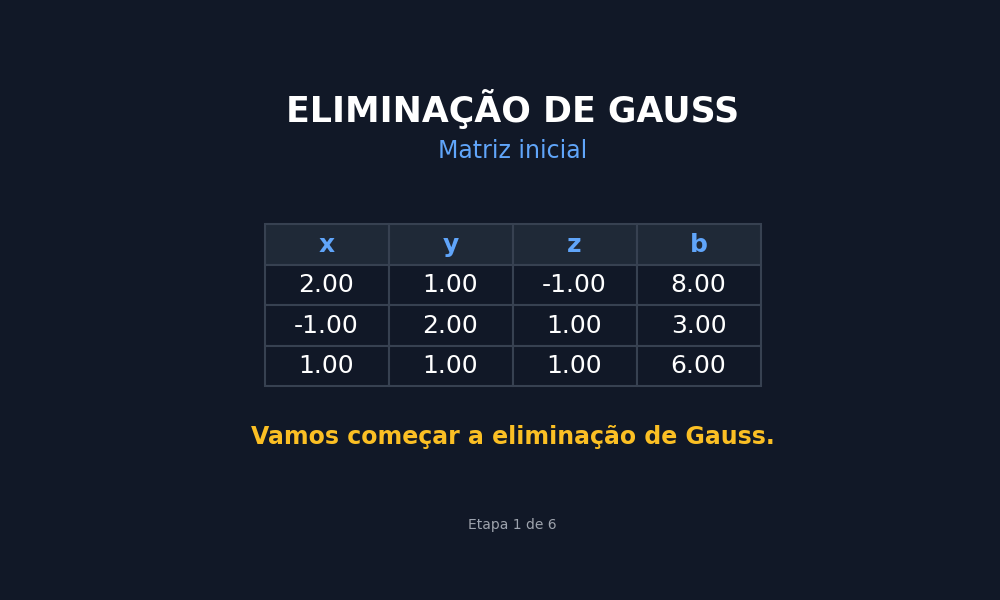

 

# 📘 Atividade — Eliminação de Gauss

### 📐 Cálculo Numérico

 

👩‍🎓 **Victoria Antônia Brito Barbosa**  
🏫 **Turno: Noturno**  
🎓 **Bacharelado em Ciência e Tecnologia — UNIFESP**

---

## 📖 Sobre a atividade

A atividade **Eliminação de Gauss** foi desenvolvida individualmente na disciplina de **Cálculo Numérico**, com foco na implementação do método numérico utilizado para resolver sistemas de equações lineares.

Por meio de Python, foram realizadas operações elementares sobre as linhas da matriz aumentada, transformando o sistema em uma matriz triangular superior. Em seguida, foi aplicada a substituição retroativa para determinar os valores das incógnitas.

Além da resolução numérica, foi desenvolvida uma animação em formato GIF para representar visualmente, passo a passo, as transformações realizadas durante o processo de eliminação e a obtenção da solução final.

---

## 🎯 Objetivos da atividade

* 🧮 Compreender o funcionamento do método da Eliminação de Gauss;
* 📐 Representar sistemas de equações lineares por meio de matrizes aumentadas;
* 🔁 Aplicar operações elementares nas linhas de uma matriz;
* 📊 Transformar a matriz em uma estrutura triangular superior;
* 🔢 Utilizar a substituição retroativa para encontrar as incógnitas;
* 💻 Implementar o método utilizando Python;
* 🎞️ Desenvolver uma animação para visualizar as etapas do processo;
* 🎯 Compreender como o método permite obter a solução de um sistema linear.

---

## 📚 Etapas da atividade

A implementação foi organizada nas seguintes etapas:

* **Parte 1 — Preparação do sistema:** representação do sistema linear por meio da matriz aumentada;
* **Parte 2 — Eliminação de Gauss:** aplicação das operações elementares para transformar a matriz em uma matriz triangular superior;
* **Parte 3 — Substituição retroativa:** cálculo das incógnitas a partir da última linha da matriz;
* **Parte 4 — Animação:** geração de um GIF demonstrando as transformações da matriz e a solução final.

---

## 📓 Atividade no Google Colab

O desenvolvimento completo da atividade, incluindo a implementação em Python, os cálculos e a animação do método, está disponível no notebook:

🔗 **[Abrir Atividade — Eliminação de Gauss no Google Colab](https://colab.research.google.com/drive/11vV-5UhEReFONBR-EIHWV-wBzGdasoru?usp=sharing#scrollTo=PCyAJbskqA9i)**

---

## 🛠️ Ferramentas utilizadas

* 🐍 **Python** — implementação do método e realização dos cálculos;
* 📓 **Google Colab** — desenvolvimento e execução do código;
* 🎞️ **GIF** — representação visual das etapas da Eliminação de Gauss.

---

## 📂 Arquivos da atividade

* 📄 **README.md** — informações e organização da atividade;
* 📓 **Notebook Google Colab** — implementação, cálculos e geração da animação;
* 🎞️ **eliminacao_gauss.gif** — animação das etapas do método da Eliminação de Gauss.

---

### 📐 Cálculo Numérico

**Atividade — Eliminação de Gauss**

 

🔗 **[⬅️ Voltar à seção de atividades](../README.md)**

